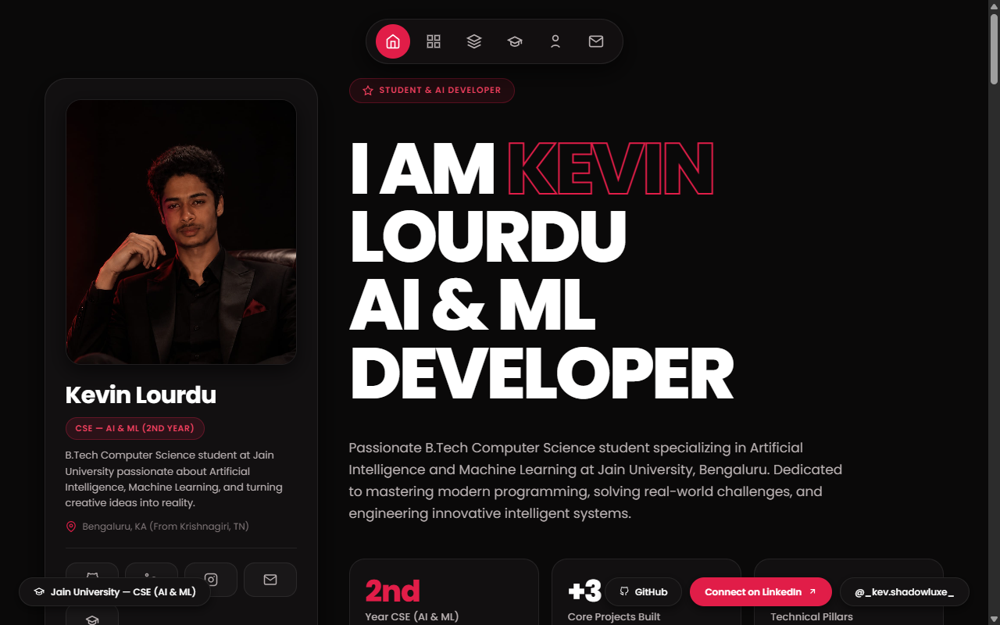
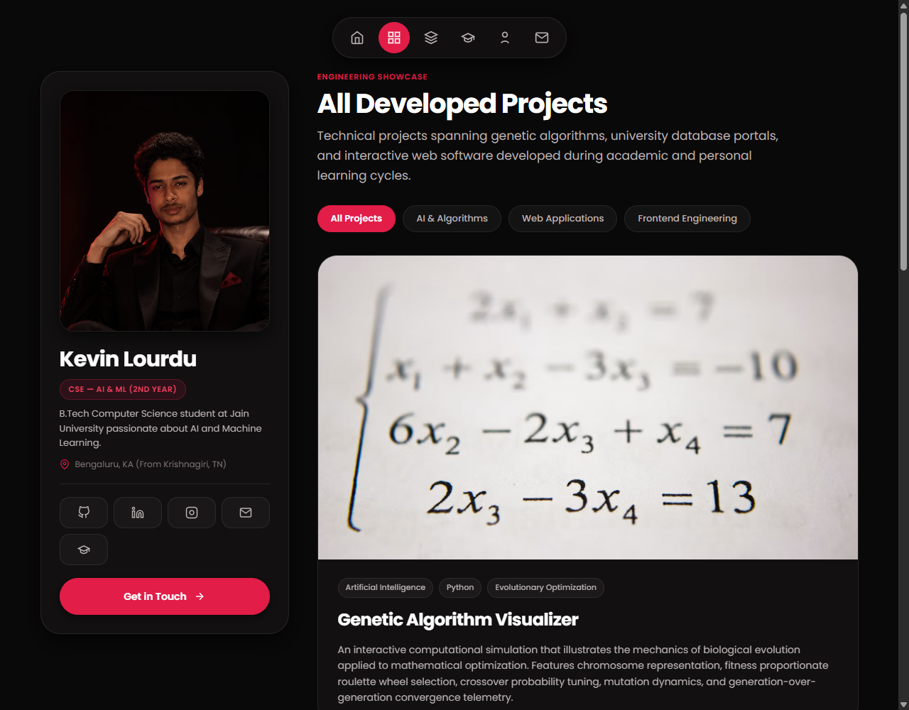

# Kevin Lourdu — Developer Portfolio & Motion Systems

[](https://kevin-lourdu-portfolio.vercel.app)
[](https://github.com/KEVINLOURDU/kevin-lourdu-portfolio)
[](https://kevin-lourdu-portfolio.vercel.app)

A modern, high-contrast, motion-rich personal developer portfolio engineered with 3D spatial perspective tilt physics, Web Audio synthesizer click feedback, and client-side SPA routing.

🌐 **Live Website:** [https://kevin-lourdu-portfolio.vercel.app](https://kevin-lourdu-portfolio.vercel.app)

---

## 📸 Website Previews

### Desktop Hero & Profile Experience


### Projects & Engineering Showcase


---

## ⚡ About the Website

The website is a high-performance personal developer portfolio built with zero framework overhead, focusing on clean engineering, fluid micro-interactions, and responsive design.

### Key Capabilities & Motion Engineering

* **Single-Page Application (SPA) Routing:**  
  Seamless hash and tab navigation (`#home`, `#projects`, `#skills`, `#education`, `#about`, `#contact`) with deep-linking support, alongside standalone HTML views for direct sharing.
* **3D Spatial Perspective Mouse Tilt:**  
  Cards calculate real-time mouse offsets from center to project mechanical 3D tilt using `perspective(1000px) rotateX(...) rotateY(...)` without layout thrashing.
* **Cursor-Following Specular Spotlight:**  
  Tracks pointer coordinates dynamically to cast a subtle radial spotlight glare across velvet noir glassmorphism card surfaces.
* **Web Audio API Tactile Sound Synthesis:**  
  Synthesizes a clean 1200Hz sine-wave transient descending to 400Hz over 12ms on interactive button clicks without external audio files.
* **Responsive Glassmorphism Design:**  
  Dark mode aesthetic built with custom CSS design tokens, smooth spring restitution, and adaptive layouts optimized for mobile, tablet, and desktop viewports.

---

## 🛠️ Technical Stack

* **Frontend:** HTML5, CSS3 Custom Properties (Variables), Vanilla JavaScript (ES6+)
* **Audio Engine:** Web Audio API (real-time frequency synthesis)
* **Hosting & CDN:** Vercel Fluid Edge Network
* **Version Control:** Git & GitHub

---

## 🚀 Featured Projects on the Site

1. **Genetic Algorithm Visualizer:** Computational simulation demonstrating evolutionary optimization, chromosome fitness calculation, roulette-wheel selection, and mutation rates.
2. **University Internship Portal:** Academic student web platform designed to streamline internship opportunities, mentor communication, and application milestones.
3. **Developer Identity & Motion Engine:** Interactive personal identity platform with tactile physics feedback and clean-room architecture.

---

## 📁 Project Structure

```
kevin-lourdu-portfolio/
├── assets/
│   ├── preview.png             # Hero & profile preview screenshot
│   └── preview-projects.png    # Projects archive preview screenshot
├── about.html                  # Standalone biography view
├── contact.html                # Standalone connect hub & message form
├── education.html              # Standalone academic qualifications view
├── index.html                  # Core Single-Page Application (SPA)
├── kevin-portrait.jpg          # Executive portrait asset
├── preview.bat                 # Windows batch launcher to open in browser
├── projects.html               # Standalone projects archive view
├── README.md                   # Project documentation & visual showcase
├── script.js                   # Motion physics, audio synthesis & SPA router
├── skills.html                 # Standalone technical stack view
├── styles.css                  # Design token stylesheet & responsive rules
└── vercel.json                 # Vercel deployment & clean routing config
```

---

## 💻 Running Locally

1. Clone the repository:
   ```bash
   git clone https://github.com/KEVINLOURDU/kevin-lourdu-portfolio.git
   cd kevin-lourdu-portfolio
   ```
2. Open in your browser:
   * On Windows: double-click `preview.bat`
   * Or open `index.html` directly in any modern web browser
